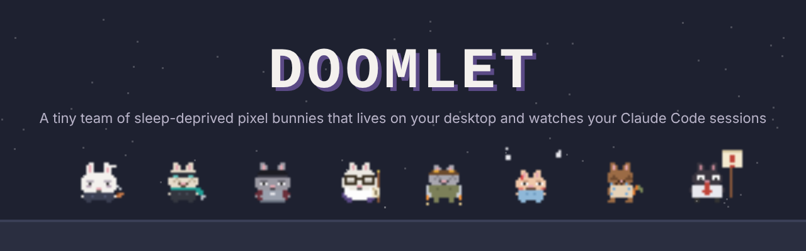
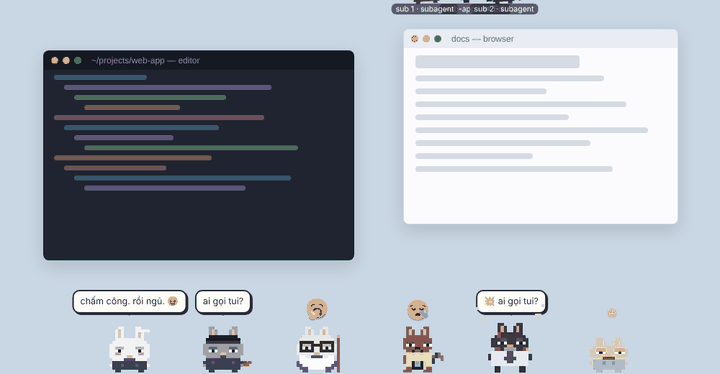
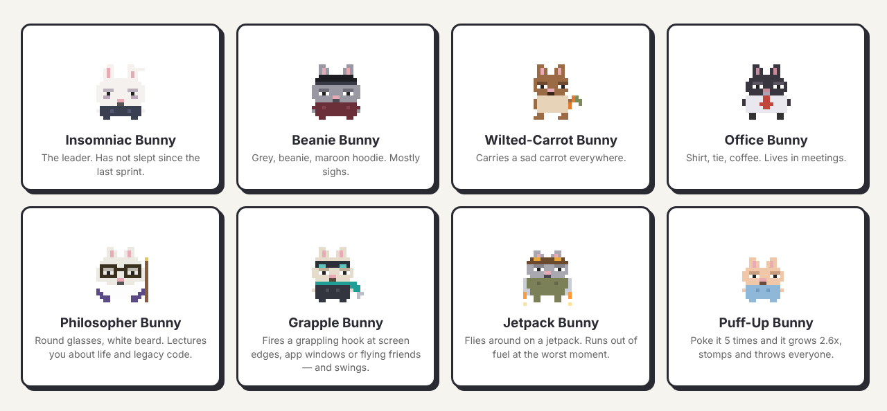
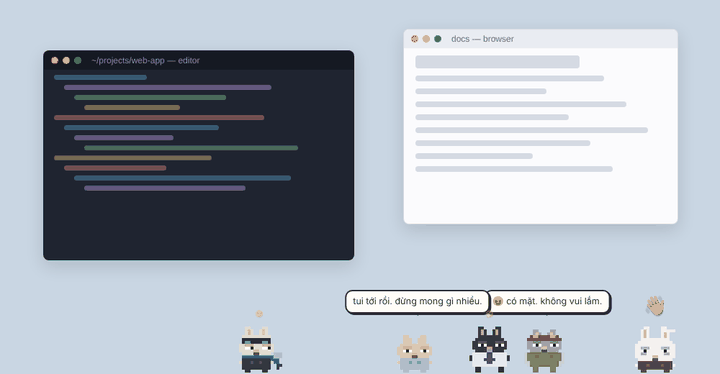
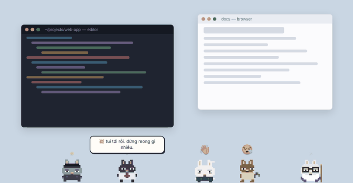

<div align="center">



# Doomlet 🐰

**A tiny team of sleep‑deprived pixel bunnies that lives on your desktop, reacts to your Claude Code sessions, argues about tabs vs spaces, and occasionally sword‑fights.**

[](LICENSE)
[](https://www.electronjs.org/)
[](#-quick-start)
[](https://github.com/kenzot25/doomlet/stargazers)
[](https://paypal.me/toandev)

[Quick start](#-quick-start) · [Features](#-features) · [Claude Code integration](#-claude-code-integration) · [Customize](#-customize) · [Tiếng Việt](README.vi.md)

</div>

---

<p align="center">
  
</p>

Doomlet puts a transparent, click‑through layer over every monitor. Little pixel bunnies walk along the bottom of your screens, sip coffee, sigh under personal rain clouds and, when you have Claude Code running, sit down with a laptop and **work along with it**: typing while tools run, raising a sign when Claude needs your approval, throwing confetti when it's done, and fainting when a tool fails.

They mostly talk in emoji. Every 30 seconds or so, one of them says something deeply relatable.

## ✨ Features

### 🐰 A cast of 8 original characters

<p align="center"></p>

### 🦸 Three bunnies with superpowers

<p align="center"></p>

| | |
|---|---|
| 🪝 **Grapple Bunny** | Fires a hook at the top of your screen, screen corners, the **title bars of your real app windows** (Windows) or a jetpack bunny flying by, then swings like a pendulum, lets go mid‑air and chains to the next anchor. In a fight it swing‑kicks people. |
| 🚀 **Jetpack Bunny** | Flies around with flames and smoke, sometimes over to another monitor. Runs out of fuel at the worst moment. In a fight it drops baguette bombs 🥖 from above. |
| 🌋 **Puff‑Up Bunny** | Gentle… until you poke it 5 times. Then it grows 2.6×, turns red, stomps (everyone bounces), picks somebody up and throws them across the screen. Deflates, embarrassed. |

### 🎭 Office drama, fully automated

<p align="center"></p>

- **Arguments** from a script of classic developer disputes: tabs vs spaces, who deployed on Friday, who drank the coffee labelled "DO NOT TOUCH", the PR with 87 comments. They end in a hug, a walk‑out, or…
- **Brawls** in a cartoon dust cloud with flying limbs and `BỐP!` `BỤP!` `#@!%`
- **Sword duels** with sparks, and **foam‑blaster standoffs** with a tumbleweed rolling by
- **The Philosopher Bunny** walks up to people and lectures them about life and legacy code. Listeners fall asleep, facepalm, run away or start a duel
- Bystanders **gather to watch**, film it on their phones and cheer
- **Grudges**: throw a bunny into another one (🎳 STRIKE) and it will come back for revenge

### 🖱️ Interaction

| Action | What happens |
|---|---|
| Click | Poke it. Five quick pokes and it gets angry (or giant) |
| Drag & drop | Pick it up and **throw** it, with gravity, bounces and collisions |
| Throw past a screen edge | It flies onto your **other monitor** (left, right, above or below) |
| Double‑click | A random trick: flip, spin, dance, ROFL, headbang |
| Right‑click | Full menu: 30+ actions, start a fight, a duel, a lecture, summon heroes |

### 🖥️ Multi‑monitor, done properly

One overlay per display, so mixed DPI and odd layouts just work. Doomlet reads the real arrangement from your OS (side by side, stacked, laptop below two monitors…). Bunnies leap sideways, jump up or drop down to the screen next to them with wind‑up, dust and a spin trail.

### 🌙 Lives quietly in the background

- Tray icon only: no window, no taskbar entry, no console
- Starts with your computer (toggle in the tray menu)
- Character size is adjustable from the tray (**Kích thước nhân vật**: Small / Medium / Large / Huge)
- Clicks pass through to the apps underneath unless you are pointing at a bunny
- Hot reload: edit any file in `renderer/` and the bunnies reload; edit `main.js` and the app restarts
- "Update & restart" in the tray runs `git pull` + `npm install`

## 🚀 Quick start

Requires **Node.js 18+**.

```bash
git clone https://github.com/kenzot25/doomlet.git
cd doomlet
npm install
npm start
```

**Windows:** just double‑click `start-doomlet.cmd`. It installs Electron the first time, then runs in the background.

**Just want a look?** Open [`demo.html`](demo.html) in your browser. It has buttons to summon the team and simulate a Claude Code session.

**Prefer an installer?** Grab the latest Windows build (`Doomlet Setup *.exe` or the portable `.exe`) from [Releases](https://github.com/kenzot25/doomlet/releases).

## 📦 Build a Windows release

```bash
npm install
npm run dist          # build locally → dist/ (NSIS installer + portable .exe)
```

Publishing is automated: push a version tag and GitHub Actions ([`.github/workflows/release.yml`](.github/workflows/release.yml)) builds on `windows-latest` and attaches the artifacts to the matching GitHub Release.

```bash
# bump "version" in package.json first (e.g. 1.5.0), then:
git tag v1.5.0
git push origin v1.5.0
```

## 🤖 Claude Code integration

No setup needed. Doomlet reads the local transcripts that Claude Code already writes to `~/.claude/projects/` (read‑only, nothing leaves your machine):

| Session state | Bunny |
|---|---|
| Running a tool | ⌨️ Typing on a laptop, tag shows the tool name |
| Thinking | 🤔 Question mark |
| Waiting for your approval | ✋ Holds up a sign |
| Done | 🎉 Confetti, someone comes over to congratulate |
| Tool error | 💥 Faints, someone comes over to laugh |
| Spawned subagents | Tiny helper bunnies appear next to it |
| Idle for 10 minutes | Clocks out and walks off screen |

Each active session gets its own bunny labelled with the project name.

**More accurate "waiting for approval":** without hooks Doomlet guesses (a tool running longer than 25 s). Install the optional hooks to know exactly when Claude asks for permission:

```bash
npm run install-hooks     # adds hooks to ~/.claude/settings.json (with a backup)
npm run uninstall-hooks
```

The hook only appends one line to `~/.doomlet/events.jsonl`, always exits immediately and never blocks Claude Code.

## 🎨 Customize

| File | What's inside |
|---|---|
| `renderer/lines.js` | All dialogue, argument scripts, lectures, time‑of‑day lines |
| `renderer/sprites.js` | 16×16 sprites drawn as text grids (one character = one pixel colour) |
| `renderer/pet.js` | Actions, emoji per mood, how often they talk (`TALK`) |
| `renderer/drama.js` | Multi‑step scenes: arguments, brawls, duels, standoffs, lectures |
| `renderer/powers.js` | Grapple physics, jetpack steering, giant mode |

Drawing a new bunny takes about five minutes: copy a grid in `sprites.js`, change the letters and colours, and it shows up in the team.

> 🗣️ The bunnies currently speak **Vietnamese** (the emoji are universal). An English line pack is the most wanted contribution. PRs welcome!

## 🔒 Privacy

- Claude Code transcripts are read locally and only to work out each session's state. Nothing is sent anywhere.
- On Windows, a hidden PowerShell process reads the **positions** of visible app windows (never their content) so the Grapple Bunny can hook onto title bars.
- A small debug log is written to `doomlet.log` in the app folder.

## 🛠️ How it works

```
main.js        one transparent window per display, tray, auto-start, hot reload, cross-screen migration
watcher.js     tails Claude Code transcripts + hook events → per-session state
winrects.js    Windows: EnumWindows via PowerShell → app window rects (anchors)
renderer/
  sprites.js   text-grid pixel sprites + props (laptop, mug, sword, jetpack flame…)
  pet.js       physics, actions, emoji, speech, session binding
  drama.js     async multi-step scenes with crowds and grudges
  powers.js    rope pendulum, jetpack steering, giant mode
  app.js       world loop, input, menus, demo mode
```

## ☕ Support

If Doomlet made your day a little less doomed, a star ⭐ helps a lot. You can also buy the bunnies a coffee:

<a href="https://paypal.me/toandev"></a>

## 📄 License

[MIT](LICENSE). All characters are original pixel art made for this project.

Doomlet is a fan project and is not affiliated with or endorsed by Anthropic.
